# Tài liệu kỹ thuật cho bài báo và poster

**Hệ thống giám sát và phát hiện té ngã thời gian thực: đai lưng TinyML + camera, hợp nhất quyết định tại máy chủ biên**

Tài liệu này gom mọi thứ nhóm viết bài cần: kiến trúc, thuật toán, thông số phần cứng, số liệu thực nghiệm, hình và bảng. Mọi con số đều sinh ra bằng script trong `report/`. Chạy lại script là có số mới, không phải chép tay (xem [mục 8](#8-tái-lập-kết-quả)).

| Việc cần làm | Đọc mục | Hình / bảng dùng ngay |
|---|---|---|
| Thông số phần cứng (năng lượng, kích thước, tần số lấy mẫu); mô tả thiết bị cho Poster | [3](#3-phần-cứng) | Bảng 3.1–3.4, `docs/wiring.svg` |
| Sơ đồ khối kiến trúc, luồng truyền tin IoT | [2](#2-kiến-trúc-hệ-thống-và-luồng-truyền-tin-iot) | `diagram_architecture`, `diagram_sequence`, `diagram_parallel_pipeline`, `diagram_fusion_state` |
| Confusion matrix, Accuracy/Precision/Recall của AI | [5.1](#51-ai-trên-đai-lưng-tinyml) | `cm_system_sisfall`, `cm_system_belt`, `cm_model_belt`, `docs/results/ai_metrics.md` |
| Độ chính xác thị giác máy tính theo điều kiện, ảnh minh họa | [5.2](#52-thị-giác-máy-tính-theo-điều-kiện) | `cm_vision`, `vision_conditions`, `vision_examples`, `vision_conditions_examples` |
| Độ trễ tổng thể (Performance Evaluation) | [5.3](#53-độ-trễ-latency) | `latency_components`, `latency_timeline`, `docs/results/latency.md` |

Mọi hình nằm trong `docs/figures/`: **PNG 300 dpi** để dán vào Word/LaTeX; biểu đồ và sơ đồ có thêm bản **SVG vector** để in poster khổ lớn (ảnh chụp minh họa chỉ có PNG). Sơ đồ khối gốc (sửa được) nằm ở `docs/diagrams/*.svg`.

---

## 1. Tổng quan

**Bài toán.** Người cao tuổi sống một mình bị ngã mà không ai biết. Cảm biến đeo người bắt được va chạm nhưng hay báo nhầm khi người dùng tự ngồi phịch hay nằm xuống. Camera thấy được tư thế nằm, nhưng dễ bị nhòe, tối hoặc che khuất, và không biết người đó ngã hay tự nằm xuống.

**Giải pháp.** Hai nguồn cảm nhận chạy **song song và độc lập**, mỗi nguồn tự kết luận tại chỗ rồi chỉ gửi kết quả gọn qua MQTT:

1. **Đai lưng** (ESP32 + IMU MPU6050): phát hiện va chạm và chạy **TinyML trên vi điều khiển** (Edge AI). Đai không cần mạng vẫn báo động tại chỗ được.
2. **Camera** (iPhone/webcam) và **Vision Node** trên máy chủ trong nhà: MediaPipe Pose ước lượng khung xương, rồi bộ phân loại hình học xác định tư thế ĐỨNG/NGỒI/CÚI/NẰM.
3. **Server Decision Fusion**: máy trạng thái hợp nhất hai nguồn. Đai mở sự cố, camera xác nhận hoặc bác bỏ, người dùng có 15 giây để hủy. Sau đó server gửi cảnh báo kèm ảnh hiện trường qua Telegram.

**Đóng góp chính (gợi ý cho phần Introduction):**
- Bộ phát hiện **kích hoạt theo đỉnh va chạm**, căn cửa sổ đúng như dữ liệu train. Trên 4500 bản ghi SisFall (22 giờ), cách này giảm báo nhầm **16 lần** so với cách trượt cửa sổ thông thường mà recall gần như giữ nguyên (mục 5.1).
- Kết hợp **AI + luật tư thế thân** (góc nghiêng trước/sau va chạm), tính trên vi điều khiển 240 MHz với model int8 có tensor arena 1,4 KB; toàn bộ firmware dùng 37 % flash, 16 % RAM.
- **Fusion đa nguồn có chịu lỗi**: mất camera thì vẫn cảnh báo theo đai, mất đai thì camera vẫn SOS khi thấy người nằm lâu, mất server thì đai tự SOS tại chỗ.
- **Đánh giá có thể tái lập**: chạy đúng mã C++ của firmware trên PC với dữ liệu công khai (SisFall, URFD) và dữ liệu đai thật. Mọi hình và bảng được sinh tự động bằng script.

---

## 2. Kiến trúc hệ thống và luồng truyền tin IoT

### 2.1 Sơ đồ khối (Kiến trúc hệ thống)

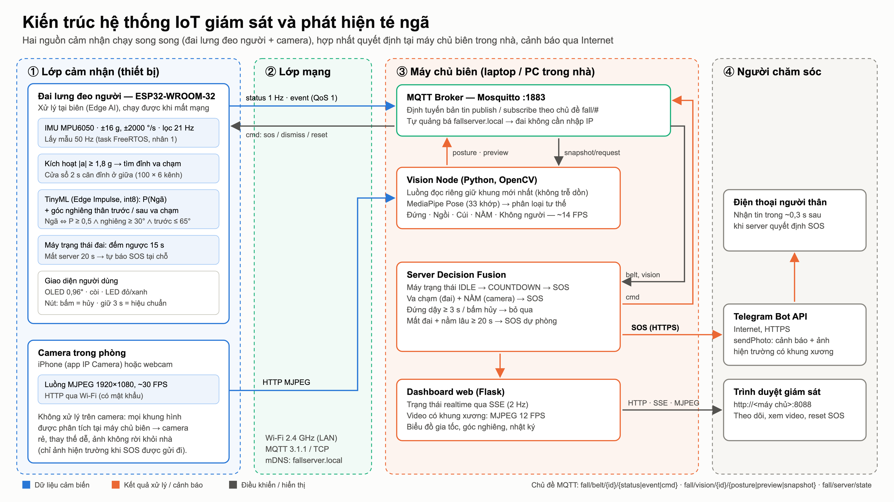

*Hình 1. Kiến trúc 4 lớp: cảm nhận (đai, camera), mạng (Wi-Fi LAN + MQTT), máy chủ biên (broker, Vision Node, Fusion, Dashboard), người chăm sóc (Telegram, trình duyệt). Nguồn: `docs/diagrams/architecture.svg`.*

| Lớp | Thành phần | Công nghệ |
|---|---|---|
| Cảm nhận | Đai lưng | ESP32-WROOM-32 (Xtensa LX6 2 nhân 240 MHz), MPU6050, FreeRTOS, Arduino core 3.x |
| | Model AI | Edge Impulse, TensorFlow Lite Micro (EON), lượng tử hóa int8 |
| | Camera | iPhone + app IP Camera (MJPEG/HTTP) hoặc webcam USB |
| Mạng | Truyền tin | Wi-Fi 802.11 b/g/n 2,4 GHz, MQTT 3.1.1 (PubSubClient trên ESP32, paho-mqtt trên Python) |
| | Tìm server | mDNS/DNS-SD: máy chủ tự quảng bá `fallserver.local` và dịch vụ `_mqtt._tcp` |
| | Cấu hình Wi-Fi | WiFiManager: đai phát Wi-Fi `FallBelt-Setup`, cấu hình qua captive portal trên điện thoại |
| Máy chủ biên | Broker | Eclipse Mosquitto 2.x |
| | Vision Node | Python 3.10+, OpenCV, MediaPipe Pose Landmarker (Full) |
| | Fusion + Dashboard | Python, Flask, Server-Sent Events, MJPEG |
| Người chăm sóc | Cảnh báo | Telegram Bot API (`sendPhoto` qua HTTPS) |

### 2.2 Chủ đề MQTT (giao thức ứng dụng)

| Chủ đề | Chiều | Tần suất | QoS | Nội dung (JSON) |
|---|---|---|---|---|
| `fall/belt/{id}/status` | đai → server | 1 Hz | 0 | trạng thái, gia tốc lớn nhất, góc thân, RSSI, `infer_ms`, heap, số mẫu bị lỡ |
| `fall/belt/{id}/event` | đai → server | khi có sự kiện | 1 | `impact` (score, peak_g, tilt), `detection`, `cancel` |
| `fall/belt/{id}/cmd` | server → đai | khi quyết định | 1 | `sos` / `dismiss` / `reset` |
| `fall/vision/{id}/posture` | camera → server | 2 Hz hoặc khi đổi | 0 | tư thế, độ tin cậy, `ts`, FPS |
| `fall/vision/{id}/preview` | camera → server | 12 FPS | 0 | JPEG 640 px cho dashboard |
| `fall/vision/{id}/snapshot/request` → `snapshot` | server ⇄ camera | khi SOS | 1 | ảnh hiện trường JPEG có khung xương |
| `fall/server/state` | server → mọi client | 2 Hz, retain | 0 | trạng thái fusion, thời gian đếm ngược còn lại |

Thiết kế: thiết bị chỉ gửi **kết quả đã xử lý** (vài chục byte), không gửi dữ liệu thô, nên mạng Wi-Fi gia đình không bị nghẽn. QoS 1 dùng cho các bản tin không được phép mất (sự kiện ngã, lệnh SOS). Nguồn: `common/protocol.py`.

### 2.3 Luồng truyền tin trong một ca ngã

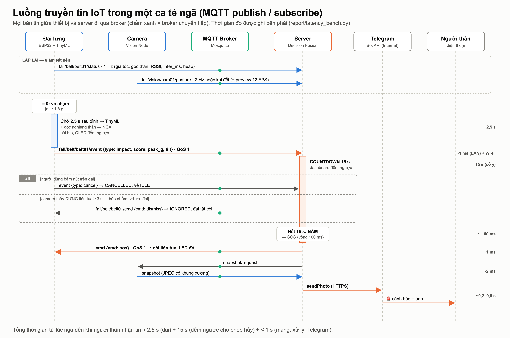

*Hình 2. Sơ đồ tuần tự. Thời gian bên phải là số đo thực (mục 5.3).*

### 2.4 Xử lý song song

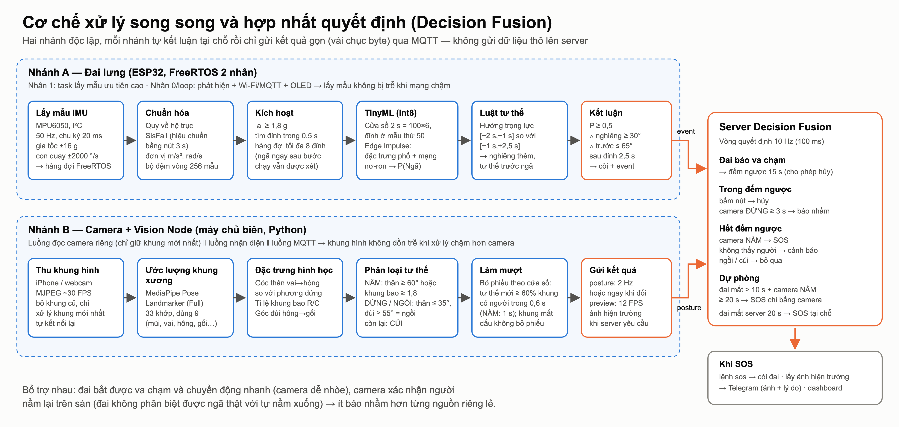

*Hình 3. Hai nhánh xử lý độc lập, chạy đồng thời và hợp nhất tại server.*

Tính song song có ở ba mức:
- **Trên ESP32:** task lấy mẫu IMU 50 Hz được ghim vào nhân 1 với mức ưu tiên cao (`xTaskCreatePinnedToCore`), đẩy mẫu vào hàng đợi FreeRTOS. Vòng `loop()` chạy bộ phát hiện, Wi-Fi/MQTT và OLED. Nhờ vậy mạng chậm hay vẽ OLED (~25 ms trên cùng bus I²C, có mutex) không làm lỡ mẫu. Số mẫu bị lỡ được báo trong `status.missed`.
- **Trên Vision Node:** có ba luồng. Luồng đọc camera chỉ giữ khung hình mới nhất (`LatestFrameReader`), luồng nhận diện, và luồng mạng MQTT. Camera phát 30 FPS mà nhận diện chỉ đạt khoảng 14 FPS, nên nếu đọc tuần tự thì hình sẽ trễ dần. Luồng đọc riêng loại bỏ hiện tượng này.
- **Trên server:** luồng MQTT nhận bản tin, luồng tick 10 Hz chạy fusion, luồng gửi Telegram, và Flask đa luồng phục vụ dashboard. Gửi Telegram (khoảng 0,3 s) không chặn vòng quyết định.

### 2.5 Máy trạng thái Decision Fusion

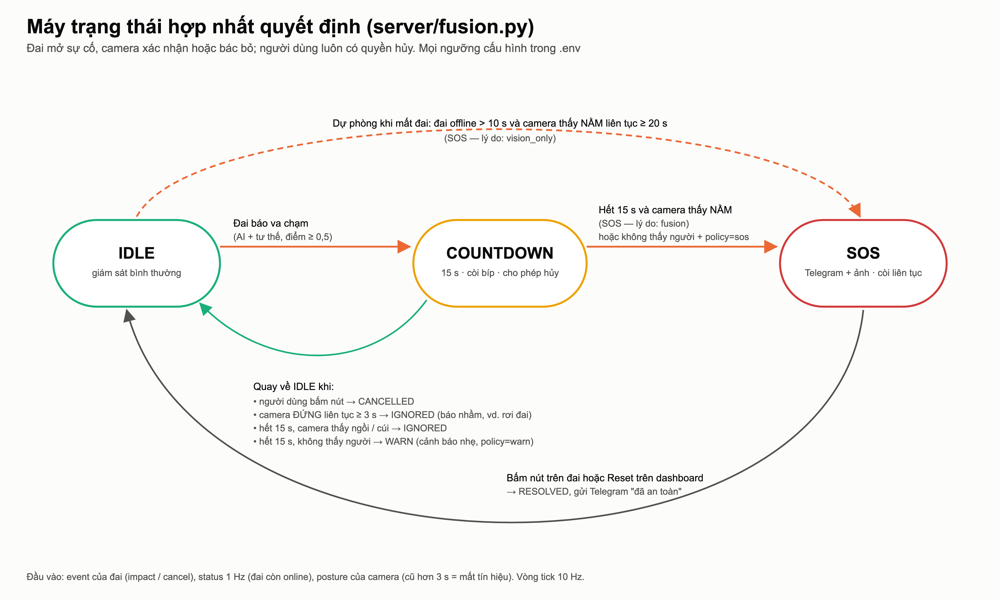

*Hình 4. Máy trạng thái hợp nhất quyết định (`server/fusion.py`).*

| Tham số (`.env`) | Mặc định | Ý nghĩa |
|---|---|---|
| `COUNTDOWN_S` | 15 s | thời gian cho người dùng hủy |
| `STANDING_CONFIRM_S` | 3 s | đứng liên tục chừng này trong đếm ngược thì coi là báo nhầm |
| `VISION_ONLY_LYING_S` | 20 s | đai offline và camera thấy nằm chừng này thì SOS |
| `MIN_IMPACT_SCORE` | 0,5 | điểm tối thiểu của sự kiện đai |
| `NO_VISION_POLICY` | `warn` | hết đếm ngược mà camera không thấy người: `warn` / `sos` / `ignore` |
| (cố định) | 3 s / 10 s | tư thế cũ hơn 3 s = mất tín hiệu camera; đai im 10 s = offline |

---

## 3. Phần cứng

### 3.1 Danh sách linh kiện và thông số

| Linh kiện | Thông số chính | Vai trò |
|---|---|---|
| ESP32 DevKit V1 (ESP32-WROOM-32) | Xtensa LX6 2 nhân 240 MHz, SRAM 520 KB, flash 4 MB, Wi-Fi 2,4 GHz + BLE | xử lý, TinyML, mạng |
| MPU6050 (GY-521; nhận cả MPU6500/9250) | gia tốc 3 trục ±16 g, con quay 3 trục ±2000 °/s, ADC 16 bit, I²C 400 kHz | đo chuyển động thân người |
| OLED SSD1306 0,96" | 128×64, I²C (0x3C) | trạng thái, đếm ngược |
| Còi chủ động (active buzzer) | 3,3–5 V | báo động tại chỗ |
| LED đỏ + LED xanh, 2 điện trở 220 Ω | | trạng thái kết nối / báo động |
| Nút nhấn (tact switch) | pull-up nội | bấm = hủy, giữ 3 s = hiệu chuẩn, giữ 8 s = cấu hình Wi-Fi |
| Nguồn | sạc dự phòng 5 V qua micro-USB | |

Sơ đồ đấu dây: [`docs/wiring.svg`](wiring.svg). Chân cắm khai báo trong `firmware/fall_belt/config.h`: I²C SDA 21 / SCL 22, còi 25, LED đỏ 27, LED xanh 26, nút 4.

### 3.2 Tần số lấy mẫu và xử lý tín hiệu

| Thông số | Giá trị | Ghi chú |
|---|---|---|
| Tần số lấy mẫu IMU | **50 Hz** (chu kỳ 20 ms, `vTaskDelayUntil`) | trùng tần số SisFall sau khi hạ mẫu 200 → 50 Hz và trùng đầu vào model |
| Dải đo | ±16 g, ±2000 °/s | giống cảm biến của SisFall (ADXL345 ±16 g, ITG3200 ±2000 °/s) |
| Lọc chống răng cưa | DLPF phần cứng ~21 Hz | < tần số Nyquist 25 Hz |
| Ngưỡng kích hoạt | \|a\| ≥ 1,8 g | chọn bằng dữ liệu đai thật (mục 5.1) |
| Cửa sổ AI | 2 s = 100 mẫu × 6 kênh, đỉnh ở mẫu 50 | |
| Thời điểm kết luận | 2,5 s sau đỉnh va chạm | cần 2,5 s để đo tư thế thân sau ngã |
| Bản tin trạng thái | 1 Hz | |
| Camera | ~30 FPS đầu vào (iPhone 1080p), xử lý ≤ 15 FPS (`--max-fps`) | |
| Thời gian nhận diện 1 khung | **13,6 ms** trung bình, p95 24,9 ms (ảnh 320×240, CPU máy chủ) | `docs/results/vision_metrics.md` |

### 3.3 Mức tiêu thụ năng lượng — ƯỚC TÍNH theo datasheet

> ⚠️ Nhóm **chưa đo bằng thiết bị**. Bảng dưới đây là ước tính từ datasheet của nhà sản xuất, dùng để định hướng. Trước khi đưa vào bài báo, nên đo thực tế theo quy trình ở cuối mục này và thay số.

Firmware giữ Wi-Fi luôn bật (`WiFi.setSleep(false)`) để nhận lệnh SOS ngay, không chờ chu kỳ ngủ của modem. Vì vậy ESP32 gần như luôn ở chế độ thu sóng.

| Thành phần | Dòng điển hình (3,3 V) | Nguồn số liệu |
|---|---|---|
| ESP32, Wi-Fi nhận liên tục, CPU 240 MHz | 95–120 mA (đỉnh khi phát 802.11b 19,5 dBm: ~240 mA, rất ngắn) | ESP32 Series Datasheet, mục Power Consumption (RF) |
| MPU6050 (gia tốc + con quay) | 3,9 mA | MPU-6000/6050 Product Specification |
| OLED SSD1306 0,96" | 8–20 mA (tùy số điểm ảnh sáng) | datasheet SSD1306 / module |
| LED xanh (sáng liên tục khi kết nối) | ~3–5 mA | (3,3 V − Vf) / 220 Ω |
| Bộ ổn áp AMS1117 + LED nguồn trên board | ~5–8 mA | datasheet AMS1117 |
| **Tổng khi giám sát bình thường** | **≈ 115–155 mA** (≈ 0,6–0,8 W tại 5 V) | |
| Thêm khi báo động: còi + LED đỏ | +25–35 mA | |

**Thời gian dùng pin (ước tính).** Sạc dự phòng 10 000 mAh (cell 3,7 V, hiệu suất tăng áp ~85 %) cho khoảng 10 000 × 3,7 × 0,85 / 5 ≈ 6 300 mAh ở 5 V, tức **khoảng 40–55 giờ** liên tục. Lưu ý: một số sạc dự phòng tự ngắt khi tải dưới ~50–100 mA. Đai tiêu thụ trên mức này nên thường không bị ngắt.

**Cách đo thực tế (đề xuất cho nhóm):**
1. Cắm **USB power meter** (loại UM25C/FNB48, khoảng 100–300 nghìn đồng) giữa sạc dự phòng và đai.
2. Ghi dòng trung bình trong 60 s ở bốn trạng thái: (a) khởi động/kết nối Wi-Fi, (b) giám sát bình thường, (c) đang đếm ngược (còi bíp), (d) SOS (còi liên tục).
3. Tính công suất P = U × I, và thời gian pin = dung lượng 5 V hiệu dụng / I trung bình.
4. Nếu cần tách riêng ESP32: dùng module INA219 nối vào nhánh 3V3.

**Hướng giảm năng lượng (cho phần Discussion):** bật modem-sleep (`WiFi.setSleep(true)`) để giảm còn khoảng 20–40 mA, đổi lại lệnh SOS từ server tới chậm hơn 100–300 ms. Có thể tắt OLED khi không có sự kiện. Có thể hạ CPU xuống 80 MHz, vì model chỉ chạy khi có va chạm.

### 3.4 Kích thước và tài nguyên

| Module | Kích thước điển hình (D × R) | Ghi chú |
|---|---|---|
| ESP32 DevKit V1 30 chân | ~51 × 28 mm | |
| GY-521 (MPU6050) | ~21 × 16 mm | gắn cố định trước bụng |
| OLED 0,96" | ~27 × 27 mm | |
| Còi | Ø 12 mm, cao 9,5 mm | |
| **Đai hoàn chỉnh** | *(nhóm đo và điền: D × R × C, khối lượng)* | |

> Kích thước module lấy theo thông số phổ biến của nhà bán. Kích thước và khối lượng của đai thật phụ thuộc hộp và cách lắp, nhóm cần đo bằng thước và cân rồi điền vào.

| Tài nguyên firmware | Giá trị |
|---|---|
| Model AI | mạng Dense nhỏ, đầu vào 78 đặc trưng, int8, tensor arena **1,4 KB** |
| Flash (chương trình) | **1,19 MB / 3 MB = 37 %** (phân vùng `huge_app`, đã gồm model + Wi-Fi + MQTT) |
| RAM tĩnh | **55 KB / 320 KB = 16 %** (còn 272 KB cho stack/heap) |
| Heap còn trống khi chạy | xem `status.heap_kb` (dashboard) |

### 3.5 Mô tả thiết bị cho Poster (đoạn ngắn, dùng ngay)

> **Đai lưng thông minh.** Thiết bị đeo bụng gồm vi điều khiển ESP32 và cảm biến quán tính 6 trục MPU6050, lấy mẫu 50 Hz. Khi phát hiện va chạm mạnh trên 1,8 g, một mạng nơ-ron TinyML (lượng tử hóa int8, bộ nhớ làm việc 1,4 KB) chạy ngay trên chip, kết hợp góc nghiêng thân người trước và sau va chạm để kết luận có phải té ngã không. Đai báo tại chỗ bằng còi, đèn và màn hình OLED, cho phép người dùng bấm nút hủy trong 15 giây, đồng thời gửi sự kiện qua Wi-Fi/MQTT. Đai tự tìm máy chủ trong nhà (mDNS) và vẫn tự phát SOS khi mất kết nối.
>
> **Camera xác nhận.** Camera thường (iPhone/webcam) truyền hình về máy chủ trong nhà. MediaPipe Pose trích khung xương 33 điểm, bộ phân loại hình học xác định người đang đứng, ngồi, cúi hay nằm. Ảnh không rời khỏi nhà, trừ ảnh hiện trường khi có SOS.

---

## 4. Thuật toán

### 4.1 Đai lưng: phát hiện va chạm + TinyML + tư thế

Mã nguồn: `firmware/fall_belt/detector.cpp`. Đây là C++ thuần, dùng chung cho ESP32 và bản kiểm thử trên PC.

1. **Chuẩn hóa hệ trục.** Mẫu MPU6050 được quy về hệ trục của SisFall (X sang phải, Y xuống chân, Z ra trước bụng), đơn vị m/s² và rad/s. Nếu gắn cảm biến theo hướng bất kỳ, người dùng giữ nút 3 s, đứng thẳng rồi cúi khoảng 45°. Firmware sẽ tìm ma trận quay và lưu vào NVS (`orientation.cpp`).
2. **Kích hoạt.** Khi |a| ≥ 1,8 g, firmware tìm mẫu lớn nhất trong 0,5 s tiếp theo làm **đỉnh va chạm**. Hàng đợi giữ được tới 8 đỉnh chờ xét, nên một cú ngã ngay sau bước chạy vẫn được xét.
3. **AI.** Cửa sổ 2 s (100 × 6) có **đỉnh nằm đúng giữa** (mẫu 50), giống hệt cách cắt dữ liệu train, được đưa vào model Edge Impulse để tính P(Ngã).
   - **Trích đặc trưng (DSP):** khối *Spectral Analysis* cho mỗi trục, gồm FFT 16 điểm có chồng lấp, log năng lượng các dải 0,1 / 0,5 / 1 / 2 / 5 Hz, 3 đỉnh phổ và thống kê thời gian. Tổng cộng **78 đặc trưng** (13 × 6 trục).
   - **Bộ phân loại:** mạng nơ-ron kết nối đầy đủ (Dense), 2 lớp đầu ra (Fall/Normal), lượng tử hóa **int8**, chạy bằng TFLite Micro biên dịch sẵn (EON), tensor arena 1,4 KB.
4. **Luật tư thế thân.** Hướng trọng lực trong khoảng [−2 s, −1 s] trước đỉnh được so với khoảng [+1 s, +2,5 s] sau đỉnh:
   - *Nghiêng thêm* = góc giữa hai vector, phải ≥ 30°.
   - *Tư thế trước va chạm* = góc thân so với phương thẳng đứng, phải ≤ 65°. Điều kiện này loại trường hợp đang nằm rồi trở mình.
5. **Kết luận.** Là té ngã khi P(Ngã) ≥ 0,5 **và** nghiêng thêm ≥ 30° **và** góc trước va chạm ≤ 65°.
6. **Máy trạng thái của đai** (`belt_logic.cpp`): IDLE → COUNTDOWN 15 s (còi bíp, OLED đếm ngược, bấm nút để hủy) → chờ lệnh từ server. Nếu server không phản hồi trong 20 s, đai **tự SOS tại chỗ**.

Ngưỡng 1,8 g được chọn bằng `tinyml/belt_collect.py eval --grid` trên dữ liệu đai thật. Ngưỡng này bắt được thêm các cú ngã nhẹ mà không làm tăng báo nhầm so với 2,0 g.

### 4.2 Camera: khung xương → tư thế

Mã nguồn: `vision/`.

1. **Thu hình:** luồng đọc riêng chỉ giữ khung mới nhất, tự kết nối lại khi camera mạng bị ngắt.
2. **Khung xương:** MediaPipe Pose Landmarker (Full, chế độ VIDEO có theo dõi qua các khung) trả 33 điểm. Hệ thống dùng 9 điểm: mũi, 2 vai, 2 hông, 2 gối, 2 cổ chân. Điểm có độ tin cậy dưới 0,3 bị bỏ.
3. **Đặc trưng hình học** (`vision/posture.py`):
   - góc thân (trung điểm vai → trung điểm hông) so với phương thẳng đứng;
   - tỉ lệ rộng/cao của khung bao các điểm;
   - góc đùi (hông → gối).
4. **Luật phân loại:**
   - NẰM nếu góc thân ≥ 60°, hoặc khung bao ≥ 1,8, hoặc (góc thân ≥ 45° và khung bao ≥ 1,2).
   - ĐỨNG/NGỒI nếu góc thân ≤ 35°: góc đùi ≥ 55° là ngồi, còn lại là đứng.
   - Các trường hợp còn lại là CÚI.
5. **Làm mượt theo thời gian (bỏ phiếu theo cửa sổ).** Hệ thống chỉ đổi sang tư thế P khi P chiếm ≥ 60 % số khung **có thấy người** trong 0,6 s gần nhất (riêng NẰM là 1 s). Khung mất dấu người không được bỏ phiếu. Chỉ chuyển sang KHÔNG CÓ NGƯỜI khi mất dấu liên tục 1,5 s.
   *Lý do (phát hiện trong quá trình đánh giá):* người nằm trên sàn bị MediaPipe mất dấu khoảng 30 % số khung. Bản làm mượt cũ đòi hỏi tư thế mới phải **liên tục**, nên một khung mất dấu là đếm lại từ đầu. Kết quả là hệ thống giữ nguyên ĐỨNG trong khi người đang nằm, và fusion có thể hiểu nhầm thành "đã đứng dậy". Bản mới tăng recall NẰM từ 25,7 % lên 44,1 % (mục 5.2).

### 4.3 Decision Fusion

Xem mục 2.5. Nguyên tắc thiết kế:
- **Đai là nguồn mở sự cố, camera là nguồn xác nhận.** Đai nhạy với va chạm và chuyển động nhanh, là lúc camera dễ nhòe. Camera thấy người còn nằm lại trên sàn, điều mà đai không phân biệt được với việc tự nằm xuống.
- **Ưu tiên không bỏ sót.** Hết đếm ngược mà camera không thấy người thì vẫn gửi cảnh báo mức nhẹ (`warn`), không im lặng.
- **Chịu lỗi từng thành phần:** mất camera thì còn cảnh báo theo đai. Mất đai thì camera vẫn SOS khi thấy nằm ≥ 20 s. Mất server thì đai tự SOS sau 20 s.

---

## 5. Kết quả thực nghiệm

### 5.1 AI trên đai lưng (TinyML)

Mọi đánh giá chạy **đúng mã C++ của firmware và model int8** biên dịch cho PC (`tools/ei_host`), không phải bản Python viết lại. Script: `python report/ai_metrics.py`.

**(a) Hệ thống trên đai, bộ dữ liệu công khai SisFall** — 4500 bản ghi, 38 người (23 người trẻ, 15 người cao tuổi), 22 giờ; mỗi bản ghi là một mẫu:

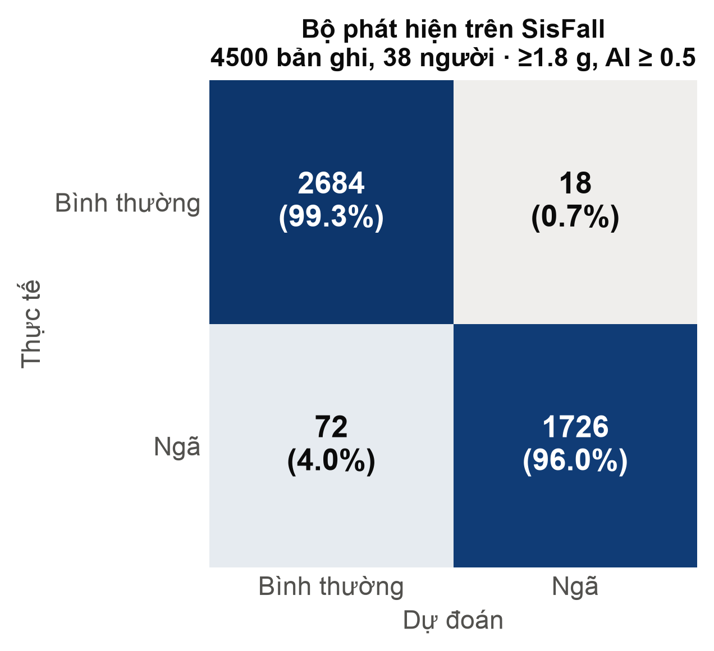

| Accuracy | Precision | Recall (Sensitivity) | Specificity | F1 | Báo nhầm |
|---|---|---|---|---|---|
| **98,0 %** | **99,0 %** | **96,0 %** | **99,3 %** | **97,5 %** | 1,24 lần / giờ sinh hoạt |

- Ca bỏ sót (72/1798) tập trung ở **ngã khi đang ngồi**: F14 ngã ngửa khi đang ngồi (17), F13 ngã trước khi đang ngồi (10), và ngã khi ngồi xuống hoặc đứng dậy (F11, F08, F09, F10). Các ca này có va chạm nhẹ, thân người không đổi tư thế nhiều.
- Ca báo nhầm (18/2702) chủ yếu là **D13 ngồi rồi nằm xuống nhanh** (10). Về cảm biến, ca này gần như giống hệt một cú ngã. Chính camera và nút hủy xử lý các ca này trong fusion.
- *Lưu ý trung thực:* model được train trên một phần SisFall, nên số liệu trên SisFall lạc quan hơn dữ liệu chưa thấy. Đánh giá (b) và (c) dưới đây dùng dữ liệu đai thật mà model chưa từng thấy.

**So sánh chiến lược phát hiện trên SisFall** (`python tinyml/stream_eval.py --grid`, ngưỡng 2,0 g):

| Cấu hình | Recall | Báo nhầm (% bản ghi sinh hoạt) |
|---|---|---|
| Trượt cửa sổ 0,5 s, P ≥ 0,8 hai lần liên tiếp (cách phổ biến) | 95,8 % | 8,1 % (17,9 lần/giờ) |
| Chỉ AI theo đỉnh (không xét tư thế) | 97,2 % | 12,1 % |
| Chỉ luật tư thế (không AI) | 97,1–97,6 % | 1,0–2,3 % |
| **Đề xuất: AI theo đỉnh + nghiêng + tư thế trước** | **95,7 %** | **0,5 %** (≈ 1 lần/giờ) |

**(b) Hệ thống trên dữ liệu đai thật** — mỗi lần thử (ngã thật lên đệm, hoặc sinh hoạt) là một mẫu. Hình `cm_system_belt.png` và bảng `docs/results/ai_metrics.md` được sinh khi có `data/belt/raw/`.

**(c) Riêng model TinyML trên cửa sổ 2 s của đai thật** — hình `cm_model_belt.png`, sinh khi có `data/belt/ei/`.

> Kết quả trên Windows ngày 10/11/2026 (trước khi đưa dữ liệu lên repo): với ngưỡng 1,8 g, bắt được **25/26** cú ngã hợp lệ, báo nhầm **2/30** lần sinh hoạt. Cả hai ca báo nhầm và ca ngã kiểu khuỵu gối từ từ bị bỏ sót đều do model AI chấm sai. Hướng khắc phục là train lại model với dữ liệu đai (`data/belt/ei/`). Chạy lại `report/ai_metrics.py` để có confusion matrix và số chính thức.

### 5.2 Thị giác máy tính theo điều kiện

Script: `python report/vision_eval.py`. Dữ liệu: **UR Fall Detection Dataset (URFD)**, gồm 30 video ngã và 40 video sinh hoạt, mỗi khung có nhãn *nằm / không nằm*. Bỏ qua khung "đang ngã", giống bài báo gốc. Hệ thống dùng nửa ảnh RGB 320×240 và xét 1/2 số khung (15 FPS, gần tốc độ chạy thật). Sáu điều kiện được mô phỏng có kiểm soát trên **cùng video**:

| Điều kiện | Cách mô phỏng |
|---|---|
| Gốc | ảnh nguyên bản |
| Thiếu sáng | giảm độ sáng còn 25 % + nhiễu cảm biến |
| Nhiễu ảnh | nhiễu Gauss σ = 20 |
| Nhòe chuyển động | nhòe ngang 15 px |
| Xa / độ phân giải thấp | thu nhỏ còn 40 % rồi phóng lại |
| Che khuất nửa dưới | che nửa dưới khung hình (bàn, giường) |

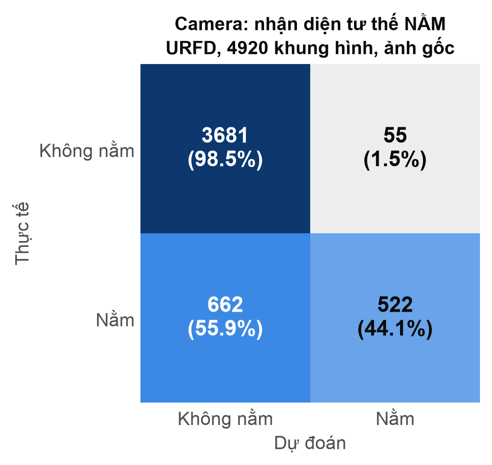 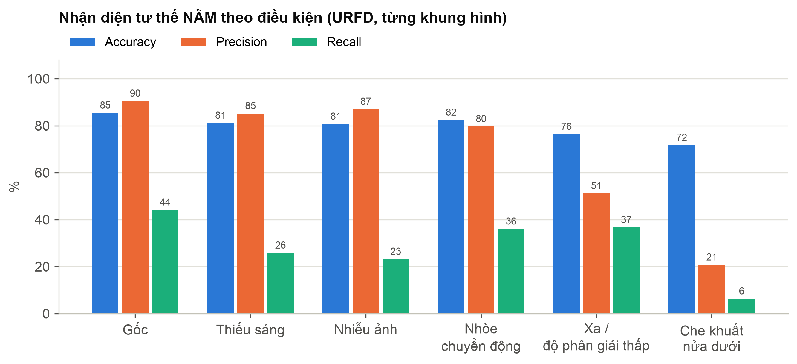

| Điều kiện | Accuracy | Precision | Recall | F1 | Phát hiện người | Chuỗi ngã được xác nhận | Video sinh hoạt bị báo NẰM |
|---|---|---|---|---|---|---|---|
| Gốc | 85,4 % | 90,5 % | 44,1 % | 59,3 % | 80,4 % | 15/30 | 4/24 |
| Thiếu sáng | 81,1 % | 85,2 % | 25,8 % | 39,6 % | 51,3 % | 11/30 | 3/24 |
| Nhiễu ảnh | 80,7 % | 87,0 % | 23,1 % | 36,6 % | 55,4 % | 11/30 | 2/24 |
| Nhòe chuyển động | 82,4 % | 79,6 % | 36,0 % | 49,6 % | 39,6 % | 18/30 | 3/24 |
| Xa / độ phân giải thấp | 76,3 % | 51,1 % | 36,7 % | 42,7 % | 75,9 % | 16/30 | 12/24 |
| Che khuất nửa dưới | 71,7 % | 20,7 % | 6,2 % | 9,6 % | 41,7 % | 1/30 | 10/24 |

Bảng đầy đủ: `docs/results/vision_metrics.md`. Lớp dương là NẰM, chỉ số tính theo từng khung sau làm mượt.

**Nhận xét (gợi ý cho phần Discussion):**
- **Precision cao, recall thấp.** Khi camera báo NẰM thì 90 % là đúng, nhưng chỉ nhận ra khoảng 44 % số khung người nằm. Nguyên nhân chính là MediaPipe **mất dấu người nằm trên sàn** ở ảnh 320×240 (khoảng 30 % khung). Mô hình tư thế được huấn luyện chủ yếu trên người đứng. Đây là lý do thiết kế fusion để **đai mở sự cố, camera chỉ xác nhận**, và có chính sách `warn` khi camera không thấy người.
- **Che khuất** là điều kiện tệ nhất (recall 6 %), tiếp theo là **thiếu sáng và nhiễu** (khoảng 25 %). Khuyến nghị lắp camera ở góc cao nhìn bao quát sàn, tránh vật che, và có đèn ngủ.
- **Xa / độ phân giải thấp** làm tăng báo nằm nhầm (12/24 video sinh hoạt), vì khung xương bị méo.
- Ảnh "Nhòe chuyển động" trong `vision_conditions_examples.png` cho thấy một trường hợp khung xương được nhận nhầm vào chiếc ghế. Hệ thống vẫn báo NẰM vì bộ làm mượt giữ kết quả các khung trước. Đây là ví dụ cần ghi chú khi đưa hình vào bài.
- **Ảnh hưởng của bộ làm mượt** (ảnh gốc, cùng dữ liệu): không làm mượt cho Recall 46,7 %; bản cũ chỉ 25,7 %; bản mới đạt 44,1 % với Precision 90,5 %. Bản mới giữ gần hết recall và vẫn lọc nhiễu.
- Thời gian xử lý khoảng 13,6 ms/khung (p95 24,9 ms) trên CPU máy chủ, đủ nhanh cho thời gian thực.

**Ảnh minh họa quá trình nhận diện:**

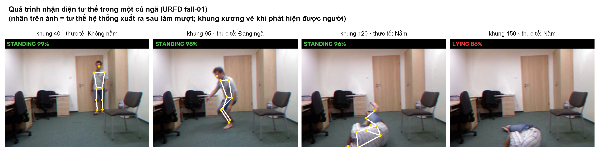
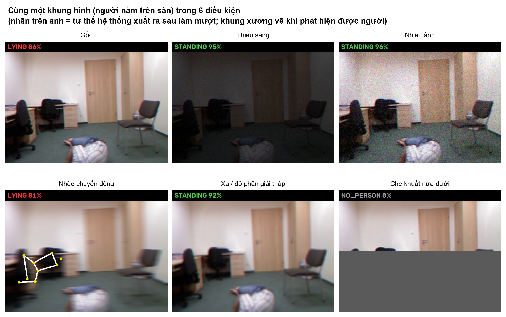

*Muốn có ảnh từ chính camera của nhóm:* khi hệ thống đang chạy, bấm nút chụp ảnh trên dashboard rồi mở `http://localhost:8088/snapshot.jpg` để lưu ảnh có khung xương (độ phân giải gốc của camera). Hoặc chụp màn hình khung video trên dashboard.

### 5.3 Độ trễ (Latency)

Script: `python report/latency_bench.py --telegram` (đo trên máy chủ, không ảnh hưởng hệ thống đang chạy) và `--live` (khi đai và camera đang bật).

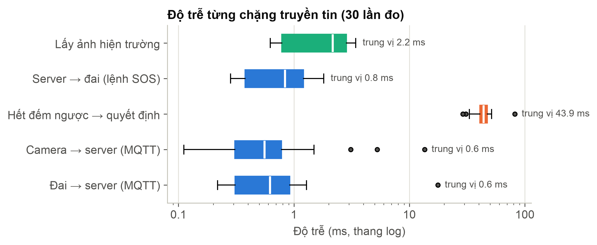
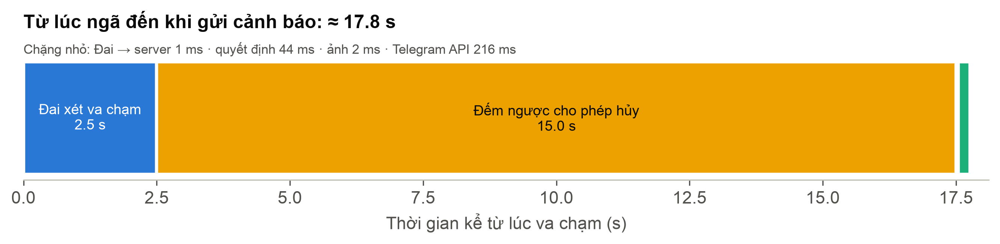

| Chặng | Trung vị | p95 | Ghi chú |
|---|---|---|---|
| Đai → server (MQTT QoS 1 + xử lý) | 0,6 ms | 1,2 ms | trên cùng máy; qua Wi-Fi cộng thêm RTT/2 (đo bằng `--live`) |
| Camera → server (MQTT QoS 0) | 0,6 ms | 0,9 ms | |
| Hết đếm ngược → quyết định SOS | 44–82 ms | ≤ 100 ms | phụ thuộc pha của vòng fusion 100 ms (trung bình lý thuyết 50 ms) |
| Quyết định → lệnh SOS tới đai | 0,8–1,0 ms | 1,5 ms | |
| Yêu cầu → nhận ảnh hiện trường (30 KB) | 2,2 ms | 3,1 ms | |
| Gọi API Telegram (HTTPS) | 0,2–0,3 s | 0,5–1,0 s | phụ thuộc Internet |
| Một bước `FusionEngine.tick()` | 0,5 µs CPU | | |
| Nhận diện tư thế 1 khung | 13,6 ms | 24,9 ms | mục 5.2 |

**Ngân sách thời gian từ lúc ngã đến khi người thân nhận tin:**

| Giai đoạn | Thời gian | Loại |
|---|---|---|
| Đai chờ đủ dữ liệu sau đỉnh, chạy AI + tư thế | 2,5 s | thuật toán (cần để đo tư thế sau ngã) |
| Truyền tin + xử lý (đai → server) | < 10 ms (ước tính qua Wi-Fi; số đo cùng máy 0,6 ms) | |
| **Đếm ngược cho phép hủy** | **15 s** | **cố ý**, cấu hình được |
| Quyết định + lấy ảnh + Telegram | ~0,4 s | |
| **Tổng** | **≈ 18 s** | trong đó phần xử lý thật chưa tới 3 s |

Thông điệp cho bài báo: độ trễ do **xử lý và truyền tin** dưới 1 s. Thành phần lớn nhất là **15 s chờ hủy có chủ ý**, đánh đổi để giảm báo nhầm. Có thể rút ngắn khi camera xác nhận NẰM chắc chắn (hướng phát triển).

**Số đo trên phần cứng thật (cần chạy khi đai bật):** `python report/latency_bench.py --live` ghi lại thời gian suy luận AI trên ESP32 (`infer_ms`), RTT Wi-Fi tới đai, RSSI, heap trống và độ trễ từ camera tới server. Số được lưu vào `docs/results/latency.json` và `latency.md`.

---

## 6. Hạn chế và hướng phát triển

- **Dữ liệu đai thật còn ít** (khoảng 35 lần ngã, 30 lần sinh hoạt, một người thực hiện, ngã lên đệm). Cần thu thêm người, thêm kiểu ngã (khuỵu gối từ từ, ngã khi ngồi) rồi train lại model trên Edge Impulse.
- **Camera yếu với người nằm** (recall khoảng 44 % trên URFD). Hướng cải thiện: YOLOv8-Pose (code đã hỗ trợ `VISION_BACKEND=yolo`), camera đặt cao, ảnh độ phân giải cao hơn, hoặc model nhận diện "người nằm" chuyên biệt.
- **Quyết định hết đếm ngược dựa trên tư thế tại một thời điểm.** Nên dùng tỉ lệ thời gian NẰM trong vài giây cuối để ổn định hơn.
- **Năng lượng mới là ước tính**, cần đo thực tế. Có thể bật modem-sleep để kéo dài pin.
- **Bảo mật:** MQTT trong LAN chưa mã hóa. Khi triển khai thật, nên bật TLS và mật khẩu cho Mosquitto.

---

## 7. Tài liệu tham khảo (gợi ý trích dẫn)

1. A. Sucerquia, J. D. López, J. F. Vargas-Bonilla, "SisFall: A Fall and Movement Dataset," *Sensors*, 17(1):198, 2017.
2. B. Kwolek, M. Kepski, "Human fall detection on embedded platform using depth maps and wireless accelerometer," *Computer Methods and Programs in Biomedicine*, 117(3):489–501, 2014. (URFD)
3. V. Bazarevsky et al., "BlazePose: On-device Real-time Body Pose tracking," CVPR Workshop on Computer Vision for AR/VR, 2020. (MediaPipe Pose)
4. R. David et al., "TensorFlow Lite Micro: Embedded Machine Learning on TinyML Systems," *MLSys*, 2021.
5. OASIS, *MQTT Version 3.1.1*, 2014.
6. Espressif Systems, *ESP32 Series Datasheet*; InvenSense, *MPU-6000/MPU-6050 Product Specification* rev 3.4.

---

## 8. Tái lập kết quả

```bash
bash scripts/setup.sh                       # Windows: powershell -ExecutionPolicy Bypass -File scripts\setup.ps1
git clone --depth 1 https://github.com/Fall-Prevention-Team/sisfallData data/sisfall_raw   # ~940 MB

.venv/bin/python report/ai_metrics.py        # 5.1  ma trận nhầm lẫn + chỉ số AI           (~1 phút)
.venv/bin/python report/vision_eval.py       # 5.2  camera theo 6 điều kiện (tự tải URFD ~100 MB, ~3 phút)
.venv/bin/python report/latency_bench.py --telegram   # 5.3  độ trễ (không ảnh hưởng hệ thống đang chạy)
.venv/bin/python report/latency_bench.py --live       # 5.3  thêm số đo trên đai + camera thật (cần đang chạy run.py)
.venv/bin/python report/render_diagrams.py   # 2    xuất sơ đồ khối SVG -> PNG (cần Chrome/Edge)
```

Kết quả được ghi vào `docs/figures/` (hình) và `docs/results/` (JSON + bảng Markdown). Trên Windows, thay `.venv/bin/python` bằng `.venv\Scripts\python`.
